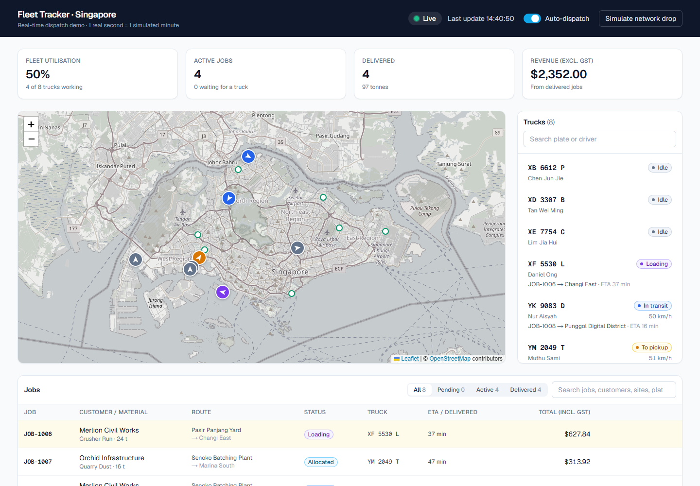

# 🚚 Fleet Tracker · Singapore

A **real-time fleet tracking and dispatch dashboard** for a construction-materials haulage company in Singapore.
Trucks move live on a map, jobs update over a push connection, dispatchers allocate trucks, and invoices are generated as PDFs in the browser.


### **▶ [Live demo: nadeesh-fleet-tracker.vercel.app](https://nadeesh-fleet-tracker.vercel.app)**

[](https://nadeesh-fleet-tracker.vercel.app)

> This is a portfolio project based on patterns I use in production on enterprise logistics portals (React, TypeScript, Redux, SignalR, Firebase). All companies, drivers and data here are fictional, and the backend is simulated in the browser so the demo runs with zero setup.

---

## Features

| | |
|---|---|
| 🗺️ **Live map** | 8 trucks move across Singapore on a Leaflet/OpenStreetMap map. Markers are rotated to the truck's heading and coloured by status. Selecting a truck flies to it and draws its route. |
| ⚡ **Real-time updates** | A hub pushes **deltas** (only the entities that changed) every second. On reconnect the client receives a **full snapshot**, so nothing is lost while offline. |
| 🔌 **Resilient connection** | Click "Simulate network drop" to see reconnects with **exponential backoff** (1s → 2s → 4s… capped at 10s) and a live status badge. |
| 🧭 **Dispatch** | Pending jobs can be allocated to idle trucks, **sorted by distance** to the pickup. The server validates each allocation and rejects races (e.g. "truck is no longer idle"). An optional **auto-dispatch** assigns the nearest idle truck. |
| 📊 **KPIs** | Fleet utilisation, active and pending jobs, tonnes delivered and revenue, all from memoised selectors. |
| 🧾 **Invoice PDFs** | Tax invoices with **9% Singapore GST**, built client-side with `pdf-lib`. The library is lazy-loaded only when you click. |
| 🌙 **Dark mode** | Follows the OS setting (and its live changes) until you flip the header switch, which is saved in `localStorage`. An inline script applies it before first paint, so there is no light flash. Map tiles, Leaflet controls and depot markers adapt, and status badge colours are unit-tested for WCAG AA contrast in both themes. |
| ♿ **Accessible** | Semantic tables, labelled controls, `aria-pressed` toggles, `role="switch"`, live regions for connection status and toasts, and keyboard-reachable map markers. |

## Architecture

```
┌──────────────────────── Browser ─────────────────────────┐
│                                                          │
│  MockFleetHub  ── "server" ───────────────────────────┐  │
│   • engine.ts: pure simulation (tick, allocateJob)    │  │
│   • SignalR-style API: start/stop/on/onClose/invoke   │  │
│   • emits snapshot (on connect) / delta (every tick)  │  │
│                                                       ▼  │
│  RealtimeProvider ── connection lifecycle + backoff      │
│        │ dispatch(snapshotReceived | deltaReceived)      │
│        ▼                                                 │
│  Redux Toolkit store                                     │
│   trucks (entity adapter) · jobs (entity adapter)        │
│   connection · ui                                        │
│        │ memoised selectors (createSelector)             │
│        ▼                                                 │
│  Header · KpiCards · FleetMap · TruckList · JobsTable    │
└──────────────────────────────────────────────────────────┘
```

**Why it's built this way**

- **The hub interface mirrors `@microsoft/signalr`'s `HubConnection`.** Swapping the mock for a real SignalR or WebSocket backend only touches `src/realtime/`. No component knows the data is simulated.
- **The simulation engine is pure and deterministic.** It takes `now`, `dt` and a seeded RNG, so the whole job lifecycle (pickup → loading → in transit → delivered) is unit-tested without timers.
- **Normalised state with `createEntityAdapter`** makes 1-second upserts cheap, and `React.memo` rows plus memoised selectors keep re-renders down to what changed.
- **Server objects are cloned before they reach Redux.** Immer freezes state in development, and the engine mutates its own copy, so sharing references would break both.
- **Code splitting:** Leaflet loads via `next/dynamic` with `ssr: false` (it needs `window`), and `pdf-lib` loads via `import()` on click. First load JS is about 125 kB.
- **Money is calculated in integer cents** to avoid floating-point errors (tested).

## Project structure

```
src/
├── app/                 # Next.js App Router (layout, page, global styles)
├── components/
│   ├── map/             # Leaflet map (client-only, code-split)
│   ├── jobs/            # Jobs table, allocation control, invoice button
│   └── ...              # Header, KPI cards, truck list, toasts
├── hooks/               # useFlashOnChange (row highlight on status change)
├── lib/                 # geo maths, backoff, formatting, invoice maths & PDF
├── realtime/            # MockFleetHub + RealtimeProvider (connection lifecycle)
├── server/              # Simulation engine + seed data (the "backend")
└── store/               # Redux Toolkit slices, selectors, typed hooks
```

## Getting started

Requires Node.js 20+.

```bash
npm install
npm run dev        # http://localhost:3000
```

| Script | What it does |
|---|---|
| `npm run dev` | Start the dev server |
| `npm test` | Run unit and component tests (Vitest + React Testing Library) |
| `npm run lint` | ESLint (Next.js core-web-vitals + TypeScript rules) |
| `npm run typecheck` | `tsc --noEmit` |
| `npm run build` | Production build |

CI (GitHub Actions) runs lint, type-check, tests and build on every push and pull request.

## Testing

35 tests across:

- **Simulation engine:** the full job lifecycle, allocation validation and race conditions, nearest-truck auto-dispatch, change tracking, and deterministic seeding
- **Library code:** haversine distance, bearing, movement, backoff, GST maths and formatting
- **Store:** snapshot vs delta reducers, connection state, KPI and filter selectors, memoisation
- **Components:** truck search and selection, job filtering, and allocation calling the hub (with a mocked hub)
- **PDF:** generated invoices are valid A4 PDFs

## Roadmap

The full backlog is in **[ROADMAP.md](ROADMAP.md)**. Highlights:

- [ ] Replace the mock hub with a real ASP.NET Core SignalR backend
- [ ] Road-following routes (OSRM) instead of straight lines
- [ ] Dark mode
- [ ] Playwright end-to-end tests

## Author

**Nadeesh Perera**, Frontend-focused Software Engineer (React · TypeScript · Next.js)
[LinkedIn](https://www.linkedin.com/in/nadeesh-perera-984461214) · [GitHub](https://github.com/NadeeshPerera)

Map data © OpenStreetMap contributors.
